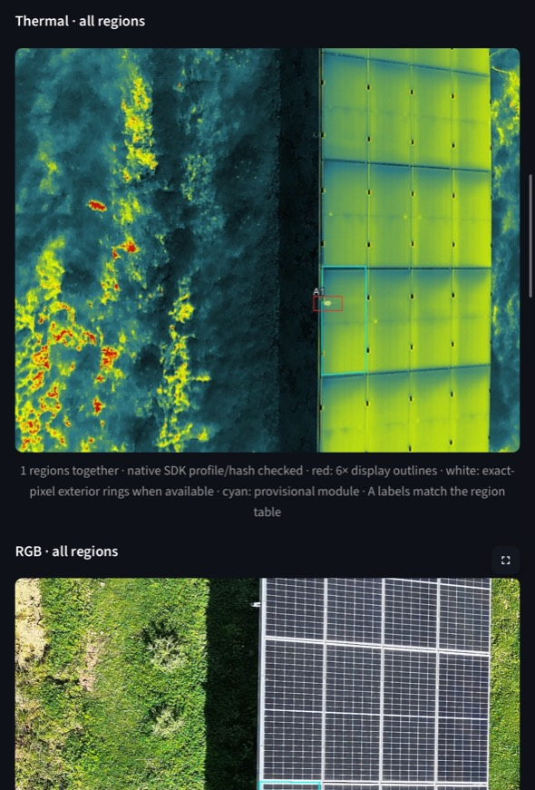
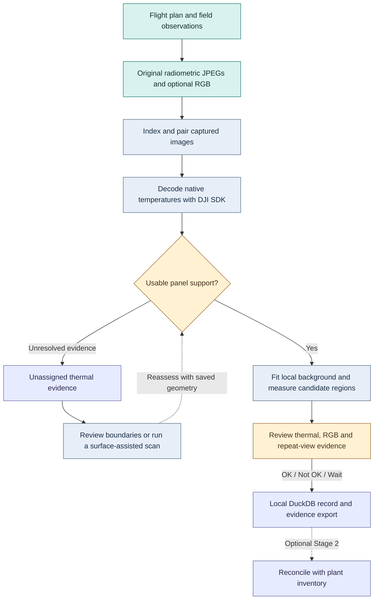

# PV Delta

**UAV radiometry and engineering review for photovoltaic inspections**

[](https://github.com/yusufzb/pvdelta/actions/workflows/ci.yml)
[](https://github.com/yusufzb/pvdelta/tree/v0.1.0.dev0)
[](LICENSE)

Aerial thermography makes it possible to screen many PV modules in one flight. The engineering challenge is to determine whether a warm region lies on a module, how much warmer it is than its local background, and what the paired images support. PV Delta plans capture geometry, reads native temperatures from DJI radiometric JPEGs, and presents traceable candidates for operator review. A plant inventory is optional.



**Figure 1.** Actual Streamlit review of a Matrice 4T field candidate. The thermal view shows the candidate near a module edge. The paired RGB view provides surface context. [Full thermal and RGB evidence](docs/results.md#paired-field-observation)

## End-to-end workflow



The main path uses native SDK temperatures and local image geometry. Unresolved surface evidence can return to boundary review. Stage 2 adds optional matching to a plant register. [Editable workflow](docs/diagrams/end-to-end.mmd) · [Architecture and supporting diagrams](docs/diagrams/README.md)

## Capabilities

| Engineering question | What PV Delta provides |
| --- | --- |
| Can the thermal image resolve the inspection target? | Approximate footprint, thermal ground sampling, pixels per target feature, capture spacing and speed estimates for the planned geometry. |
| Which pixels belong to the module? | Proposed or reviewed module boundaries, source-bound surface exclusions and a separate queue for unresolved thermal evidence. |
| How large is the temperature difference? | Native DJI SDK readings, a robust module-local reference, exact candidate pixels and measured ΔT in kelvin. |
| What supports the interpretation? | Paired thermal and RGB views, registration checks, repeat-view evidence where supported and operator decisions. |
| What can be reviewed later? | A local DuckDB inspection record, source provenance and an exportable evidence bundle. |

## Dashboard walkthrough

**Basic** starts a scan, shows processing coverage and opens candidate review. Compare thermal and RGB evidence, inspect the measurement and record **OK**, **Not OK** or **Wait**. Use the original views and the stated registration quality when interpreting a mark.

**Advanced** exposes flight planning, field observations, native scans, panel boundaries, unassigned evidence, RGB quality, mapping, panel review and export. The orthoview tab offers an experimental visual overview. The guide maps each tab to its inputs, method and outputs. [Illustrated operator guide](docs/user-guide.md)

## Scientific basis

At capture planning, the flat-plane approximation starts from camera-to-plane range $d$ and axis field of view $\theta$. The projected footprint along an axis is $2d\tan(\theta/2)$ before the axis-specific tilt correction. Dividing by the native thermal pixel count gives metres per pixel along that axis. The planner uses the coarser axis for minimum-feature estimates.

Within eligible module support, the detector fits a robust local plane $B_i(x,y)$ to native temperatures. For an exact connected component $C$, it reports

$$
\Delta T_C = \mathrm{median}_{(x,y)\in C}\left[T(x,y)-B_i(x,y)\right].
$$

Here $T$ and $B_i$ are in °C and $\Delta T_C$ is in K. The exact pixel set, fitted background and camera settings determine the measurement. Display palettes and locator enlargement affect visual presentation. [Computational methodology](docs/methodology.md) · [Radiometric equations and field evidence](docs/method.md)

## Architecture

Streamlit and the CLI share the scan and analysis code. The decoder binds measurements to an SDK profile, geometry supplies eligible support, and DuckDB connects the result to source views and operator review. Export bundles preserve the measurement context. [System architecture](docs/architecture.md) · [Scientific computation, data flow and navigation](docs/diagrams/README.md)

## Engineering results

| Evidence | Observed result | Scope |
| --- | ---: | --- |
| Matrice 4T field candidate in Figure 1 | 28.94 °C region median, +2.95 K local ΔT, 13 exact pixels | Single operator-reviewed example with reported surface debris |
| Local Matrice 4T flight | 1,239 thermal frames processed | Processing coverage |
| DJI SDK wrapper vs. manufacturer CLI | 2,621,440 identical values | Eight public M4T and M30T samples under identical effective settings |

The results page includes the full field views and a temperature transect from an external radiometric sample processed by PV Delta. [Figures, source settings and interpretation](docs/results.md)

## Validation

Software checks cover flight geometry, candidate measurement, provenance, RGB transfer, review flows and export. The SDK/CLI comparison checks decoding agreement with the manufacturer’s executable. Field temperature accuracy, independent detection performance and physical module deduplication remain evaluation priorities. The reporting workflow uses IEC TS 62446-3 as a reference for inspection evidence. [Validation scope and reproducibility](docs/validation.md)

## Installation and quick start

Install Python 3.10 or later and obtain the DJI Thermal SDK separately for native inspection. The Windows launcher looks for the SDK in the checkout at `sdk/tsdk-core/lib/windows/release_x64`. For another location, pass `-SdkLibrary` to both launcher commands.

```powershell
py -3.12 -m venv .venv
.venv\Scripts\python.exe -m pip install -e '.[dashboard,vision,storage]'
.\scripts\Start-PvDelta.ps1 -CheckOnly
.\scripts\Start-PvDelta.ps1 -BindAddress 127.0.0.1
```

Open **http://127.0.0.1:8765**. [SDK path and setup](docs/stage1-pilot.md) · [Single-flight CLI](docs/stage1-cli.md) · [Batch scanning](docs/stage1-batch.md)

<details>
<summary>Run a reproducible demonstration without the SDK</summary>

The separate demonstration injects a synthetic +10 K region with a known reference. It is intended for checking the interface and numerical workflow.

```bash
python -m pip install -e ".[dashboard]"
python -m streamlit run examples/synthetic_dashboard.py
```

</details>

## Example use cases

- **Flight preparation.** Estimate the thermal resolution and capture spacing needed for a target feature on a tilted PV array.
- **Post-flight triage.** Prioritise thermal candidates for follow-up using native-pixel measurements and source views.
- **Engineering reproducibility.** Recheck a measurement with its saved SDK settings and preserve the operator decision and supporting evidence.

## Repository structure

| Path | Contents |
| --- | --- |
| [src/pvdelta/](src/pvdelta/) | Acquisition, thermal decoding, geometry, measurement, review and storage |
| [dashboard/](dashboard/) | Streamlit application |
| [scripts/](scripts/) | Local launcher and inspection utilities |
| [tests/](tests/) | Numerical, workflow and integration tests |
| [docs/](docs/) | Methods, figures, workflows and operator guidance |

## Limitations and development priorities

Field conditions and camera settings affect interpretation. Reflections, shadows, partial masks and poor local RGB registration can leave a candidate unresolved. A processing count represents frames, while observations and provisional panel groups have their own denominators. Stable physical IDs require registration or site evidence. Future evaluation should measure both missed faults and false findings on independent, field-verified inspections. [Validation and remaining evidence](docs/validation.md)

## Author, citation and license

Created by **yusufzb**. Suggested software citation: yusufzb. *PV Delta*. Version 0.1.0.dev0. GitHub. Include the exact commit for reproducible work. [Tagged version](https://github.com/yusufzb/pvdelta/tree/v0.1.0.dev0)

[MIT code license](LICENSE) · [Figure provenance and usage terms](docs/assets/IMAGE-CREDITS.md)
