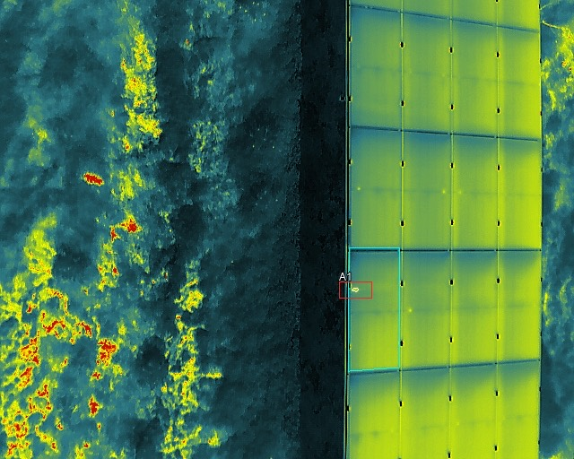
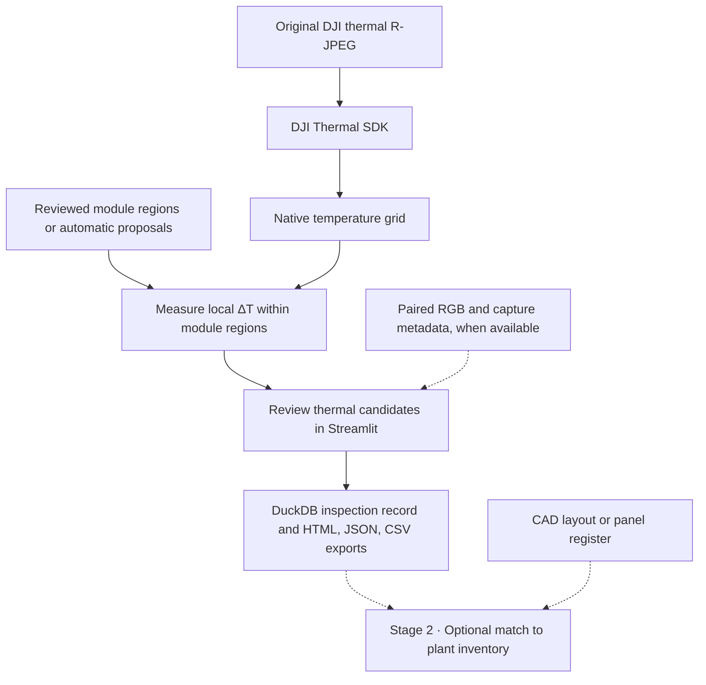
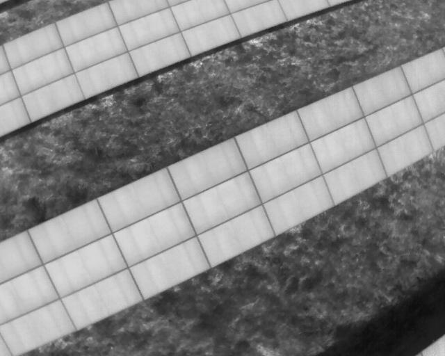

# PV Delta

**Radiometric analysis of photovoltaic modules from UAV thermal imagery**

[](https://github.com/yusufzb/pvdelta/actions/workflows/ci.yml)
[](https://github.com/yusufzb/pvdelta/tree/v0.1.0.dev0)
[](LICENSE)

PV Delta reads per-pixel temperatures from DJI radiometric JPEGs and measures
local temperature differences within photovoltaic module regions. It presents
the temperature, reference, image location and supporting evidence for each
candidate in a local Streamlit dashboard. A plant inventory is optional.

[Field case](#field-case-debris-reported) · [Workflow](#workflow) · [Detection method](docs/method.md) · [Radiometric example](#radiometric-example) · [Run PV Delta](#run-pv-delta)

## Field case · debris reported



**Figure 1a.** Full Matrice 4T thermal view selected from PV Delta's Streamlit
review. The white ring traces the 13 native candidate pixels. The red rectangle
is a 6× display locator, and cyan shows the proposed module boundary.


**Figure 1b.** Full supplied RGB view of the reported debris. The red locator
is an approximate projection. Local cross-camera alignment did not pass the
geometry check.

| Region median | Local ΔT | Native support |
| ---: | ---: | ---: |
| 28.94 °C | +2.95 K | 13 pixels |

ΔT is the median of the pixel-level differences against the fitted local
background. The figure illustrates one reviewed thermal candidate. [Image credits and measurement notes](docs/assets/IMAGE-CREDITS.md)

## Workflow



**Stage 1** measures temperature differences on the native DJI SDK grid. Within
each eligible module interior, a robust local plane estimates the background.
The detector thresholds the pixel-level temperature residuals and groups
four-connected pixels into candidates. The reported ΔT is the median residual
over the exact component. Display palette and box enlargement do not enter the
calculation. The dashboard retains original image coordinates and shows
geographic estimates when supporting geometry is available.

$$
\Delta T_C = \operatorname{median}_{(x,y)\in C}\left[T(x,y)-B_i(x,y)\right].
$$

[Radiometric assumptions, equations and screening settings](docs/method.md)

**Stage 2** uses plant records to associate reviewed observations with physical
panel IDs, rows, racks and strings. [Measurement profiles](docs/measurement-profiles.md) · [Evidence export](docs/inspection-export.md)

## Radiometric example


**Figure 2.** Real Matrice 4T sample from STR Drones. The left panel visualizes
the native 640 × 512 SDK temperature grid with a 2nd–98th percentile display
range. The line on the right uses the original decoded values from row 256.
This figure demonstrates radiometric decoding. [Source, settings and reproduction](docs/assets/IMAGE-CREDITS.md)



**Figure 3.** PV module rows captured by a DJI Mavic 3T in the CERTH public
dataset. [Image credits and source](docs/assets/IMAGE-CREDITS.md)

## Validation and scope

| Check | Result |
| --- | --- |
| Local Matrice 4T flight processing | 1,239 thermal frames processed |
| DJI SDK integration vs. manufacturer CLI | 2,621,440 identical temperature values across eight public M4T and M30T R-JPEG samples, using the same effective settings |

The comparison measures agreement between two software paths. Automatic hotspot
detection accuracy across sites, same-panel matching across captures and
reflection assessment remain under evaluation. PV Delta is a research pilot
for operator review. [IEC TS 62446-3:2017](https://webstore.iec.ch/en/publication/28628)
informs the inspection evidence and reporting scope. Actual equipment,
environmental and procedural requirements still need verification for each
inspection before claiming conformity.
[Public radiometric samples](https://huggingface.co/datasets/STRDrones/DJI) · [IEC evidence checklist](docs/method.md#6-iec-ts-62446-3-and-field-evidence)

## Run PV Delta

For a real inspection, install the DJI Thermal SDK and follow the
[Windows setup and operator guide](docs/stage1-pilot.md). The application opens
at **http://127.0.0.1:8765**.

```powershell
.\scripts\Start-PvDelta.ps1 -BindAddress 127.0.0.1
```

To explore the same measurement pipeline without a camera or SDK, run the
separate Streamlit example. It uses generated temperatures with a known **+10 K**
region so you can check the overview, row selector and candidate details.

```bash
python -m pip install -e ".[dashboard]"
python -m streamlit run examples/synthetic_dashboard.py
```

For automation, see the [CLI](docs/stage1-cli.md) and [batch guide](docs/stage1-batch.md).
For development, see [local setup and tests](docs/development.md).
