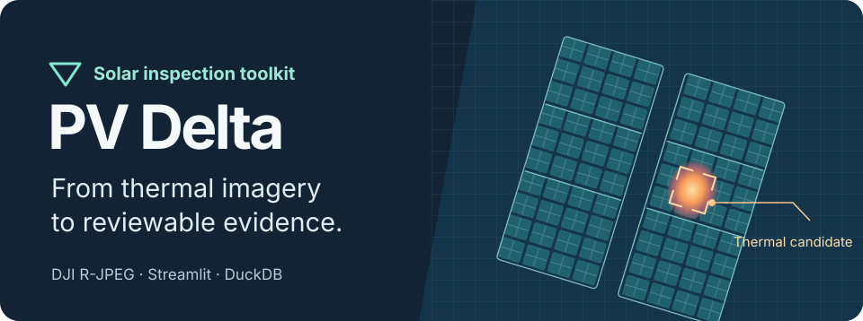
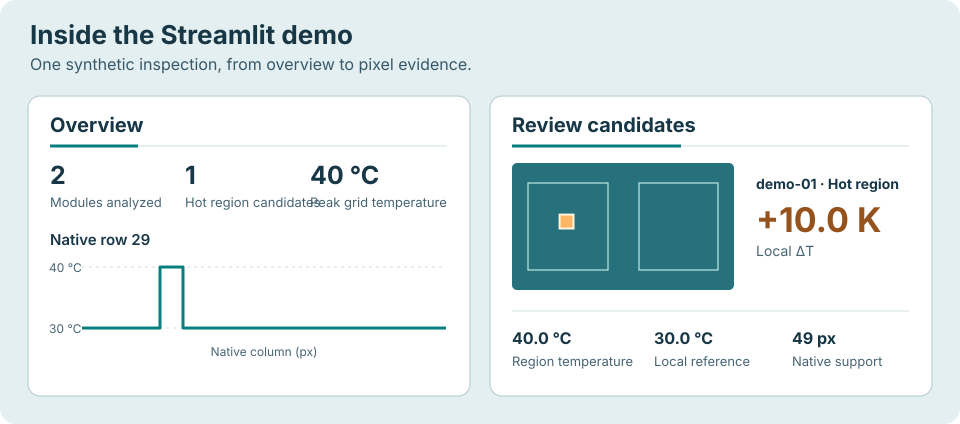
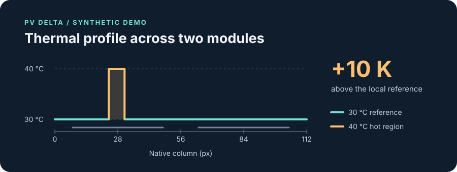

# PV Delta



**Radiometric inspection of solar PV modules from DJI thermal imagery.**

[](https://github.com/yusufzb/pvdelta/actions/workflows/ci.yml)

[](LICENSE)

PV Delta reads native temperature measurements from radiometric JPEGs, finds
thermal anomaly candidates within module regions, and presents the evidence in
a local Streamlit dashboard. It works without a plant asset register. Operators
can review candidates alongside RGB imagery and export the inspection record.

[Open the Streamlit demo](#streamlit-demo) · [Try the CLI](#try-the-demo) · [Set up a real inspection](docs/stage1-pilot.md)

## Streamlit demo



_Illustrated previews of the runnable synthetic dashboard._

The **Overview** tab lets you explore temperatures one row at a time. **Review
candidates** shows the position, temperature and local reference of the region
the PV Delta pipeline found. The example uses generated data and runs without the
DJI SDK.

```bash
python -m pip install -e ".[dashboard]"
python -m streamlit run examples/synthetic_dashboard.py
```

## What the pilot does

| Step | Output |
| --- | --- |
| Read | Index drone captures and decode original DJI R-JPEG temperatures with the DJI Thermal SDK. |
| Measure | Compare candidate regions against a local temperature reference and report the difference in kelvin (ΔT). |
| Review | Inspect thermal and paired RGB evidence, available repeat views, and estimated positions with quality information. |
| Export | Save provenance and review decisions in DuckDB and export an inspection as HTML, JSON and CSV. |

The inspection keeps frame observations and anomaly candidates distinct from
physical panel IDs. Plant inventory matching is an optional second stage.

## Try the demo

From the repository root, using Python 3.10 or newer:

```bash
python -m pip install -e .
python examples/synthetic_inspection.py out/demo
```

The expected result is a **+10 K** hot region. Open
`out/demo/synthetic-overlay.svg` to see its location. The demo also writes CSV
and JSONL. It uses generated temperatures and supplied module regions, so it
runs without a drone, an SDK, or field imagery.



## Run an inspection

Follow the [Windows setup and operator guide](docs/stage1-pilot.md) to install the
dashboard and configure the DJI Thermal SDK. Start the dashboard with:

```powershell
.\scripts\Start-PvDelta.ps1 -BindAddress 127.0.0.1
```

Open **http://127.0.0.1:8765**. The SDK, original imagery, and inspection databases
are kept locally. For scripted analysis with reviewed module regions, see the
[CLI guide](docs/stage1-cli.md) and [batch guide](docs/stage1-batch.md).

## Validation and scope

The pilot was exercised on **1,239 M4T thermal frames**. On eight public M4T and
M30T radiometric samples, the software and DJI CLI produced **2,621,440 identical
temperature values** at the same effective settings.
[Public SDK samples](https://huggingface.co/datasets/STRDrones/DJI)

The SDK comparison verifies decoding consistency. Automatic hotspot detection
accuracy across sites, physical panel identity across captures, and reflection
assessment remain under evaluation. This pilot supports operator review and
does not claim IEC field compliance.

## Project guides

- [Flight scan and radiometric settings](docs/flight-scan.md)
- [Measurement profiles and evidence](docs/measurement-profiles.md)
- [Inspection export and verification](docs/inspection-export.md)
- [Development and tests](docs/development.md)
- [MIT license](LICENSE)
