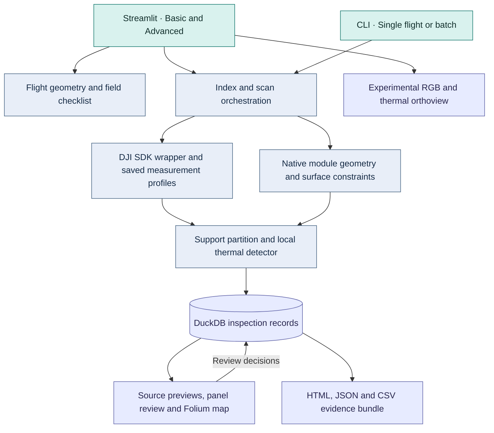
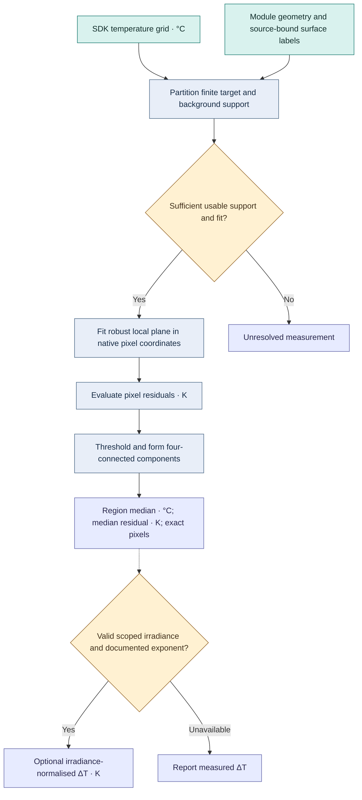
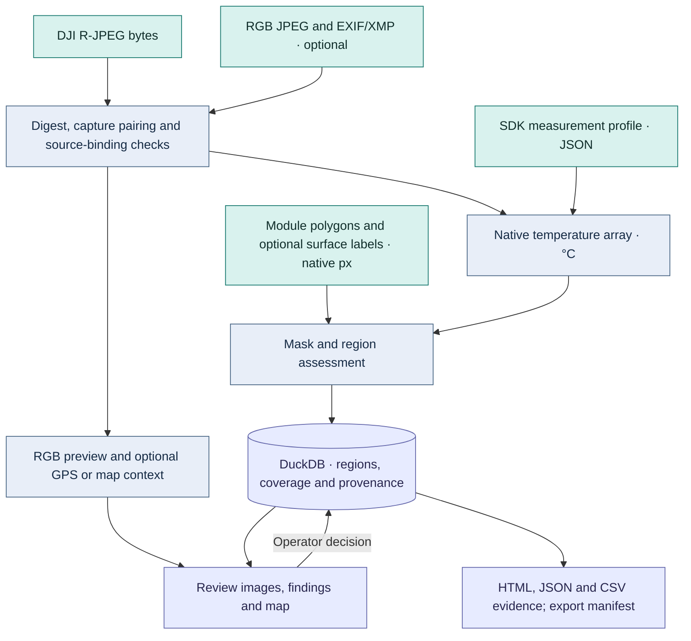
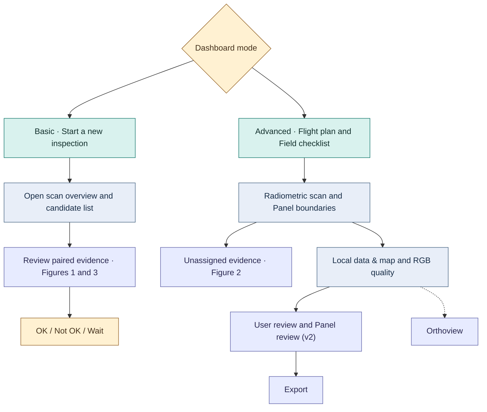

# PV Delta engineering diagrams

Teal nodes indicate inputs, blue nodes indicate computations, amber diamonds indicate decisions, and lavender nodes indicate outputs or operator views. Dashed arrows indicate optional paths or reassessment.

## End-to-end analysis

The [main workflow](../../README.md#end-to-end-workflow) starts at capture planning and ends with reviewed output. [Editable Mermaid source](end-to-end.mmd) · [SVG](end-to-end.svg)

Implementation follows [flight planning](../../src/pvdelta/flight.py), [indexing](../../src/pvdelta/ingest.py), [native scanning](../../src/pvdelta/native_flight.py), [unassigned evidence](../../src/pvdelta/native_gap_review.py), [Basic review](../../src/pvdelta/basic_dashboard.py), [export](../../src/pvdelta/inspection_export.py) and [identity storage](../../src/pvdelta/identity_store.py).

## System architecture

Streamlit and the CLI share the scan and measurement functions. DuckDB links source evidence, review and export. [Editable Mermaid source](system-architecture.mmd) · [SVG](system-architecture.svg)

[`dashboard/flight_planner.py`](../../dashboard/flight_planner.py), [`basic_dashboard.py`](../../src/pvdelta/basic_dashboard.py), [`native_flight.py`](../../src/pvdelta/native_flight.py), [`store.py`](../../src/pvdelta/store.py) and [`inspection_export.py`](../../src/pvdelta/inspection_export.py).

## Scientific computation

Candidate temperature is measured within eligible native support. The optional irradiance calculation is downstream of the measured residual. [Editable Mermaid source](scientific-pipeline.mmd) · [SVG](scientific-pipeline.svg)

[`decode.py`](../../src/pvdelta/decode.py) (`RJpeg.temperature`), [`support_partition.py`](../../src/pvdelta/support_partition.py) (`partition_measurement_support`), [`detect.py`](../../src/pvdelta/detect.py) (`assess_intra_module_anomalies`), [`conditions.py`](../../src/pvdelta/conditions.py) and [`normalize.py`](../../src/pvdelta/normalize.py).

## Data flow and units

Native thermal coordinates remain the measurement reference. RGB, GPS and display layers provide interpretation and context. [Editable Mermaid source](data-flow.mmd) · [SVG](data-flow.svg)

[`ingest.py`](../../src/pvdelta/ingest.py) (`index_flight_folder`), [`measurement_profile.py`](../../src/pvdelta/measurement_profile.py), [`store.py`](../../src/pvdelta/store.py) and [`inspection_export.py`](../../src/pvdelta/inspection_export.py).

## Dashboard navigation

Basic guides the inspection and review workflow. Advanced provides access to diagnosis, boundaries, mapping and export. [Editable Mermaid source](dashboard-navigation.mmd) · [SVG](dashboard-navigation.svg)

[`basic_dashboard.py`](../../src/pvdelta/basic_dashboard.py), [`flight_planner.py`](../../dashboard/flight_planner.py), [`panel_review_ui.py`](../../src/pvdelta/panel_review_ui.py) and the [illustrated guide](../user-guide.md).
