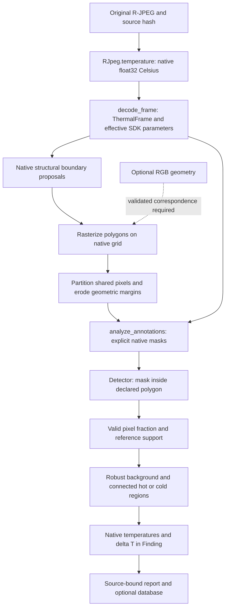

# Native temperature to candidate: measurement path

This is the native-flight route. It uses `partition_measurement_support`, which
removes ambiguous shared pixels from every overlapping envelope. The separate
`build_measurement_support` API instead requires disjoint input envelopes; it is
not the native-flight builder. Neither establishes that an envelope is a panel.

`analyze_annotations` checks mask containment before computing module statistics.
`assess_intra_module_anomalies` and `assess_inter_module_anomalies` also enforce
containment at their own entry points, including calls that bypass orchestration.
An out-of-polygon mask is an invalid input, not a healthy module. Both detector
paths now apply the configured valid-pixel-fraction and reference-support gates;
a small surviving hot patch cannot represent an otherwise invalid whole module.

The detector measures only original native Celsius pixels. RGB, thermal JPEG
colours, enlarged display boxes and interpolated previews do not supply
temperatures. Polygon coordinates use pixel boundaries; a full50x50 grid has
outer bounds0..50, not0..49.

The most important remaining boundary is semantic: a well-formed polygon over
vegetation can pass containment and still be the wrong object. Native structural
proposals therefore remain provisional. No heat threshold, geometric overlap,
source hash or software test establishes physical panel identity, glare clearance
or an electrical fault. Those require separate panel/reference and repeat-view
evidence.

Whole-module comparisons require explicit local peer groups. Detection settings
are exploratory thresholds, not IEC severity or field-accuracy acceptance.
