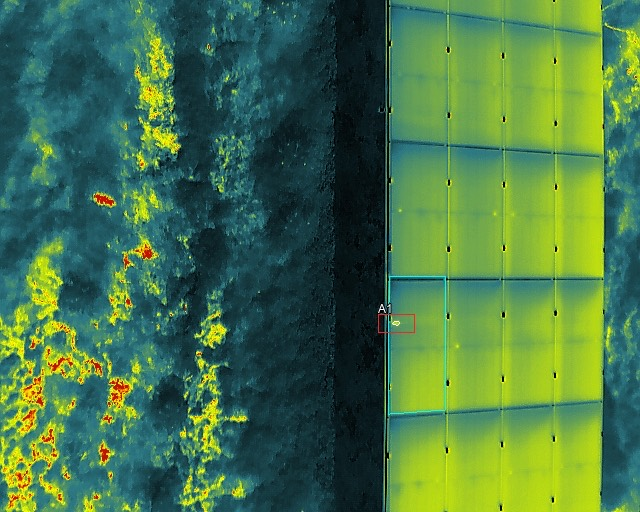
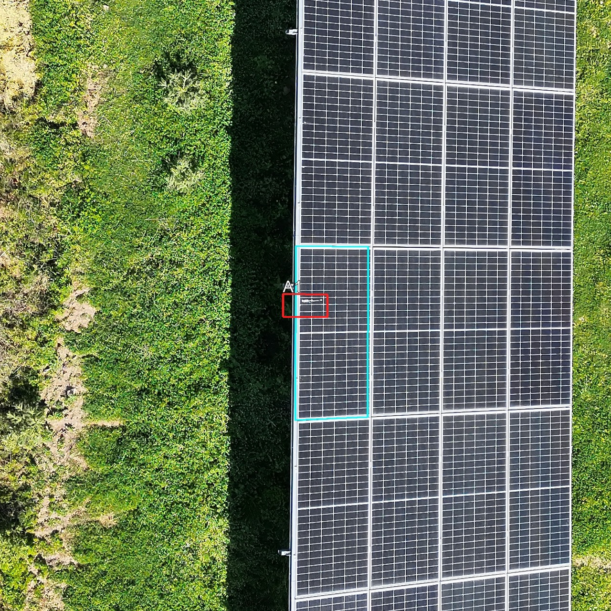
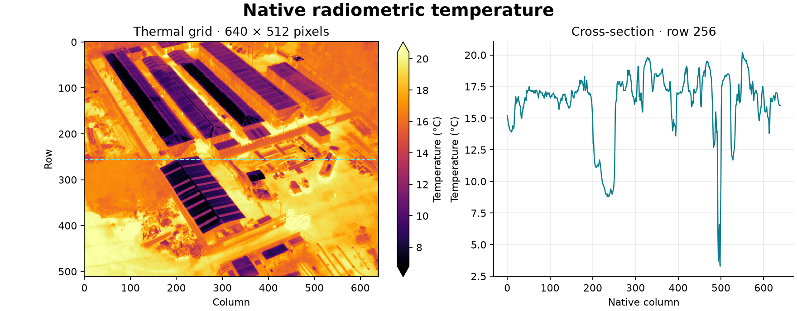
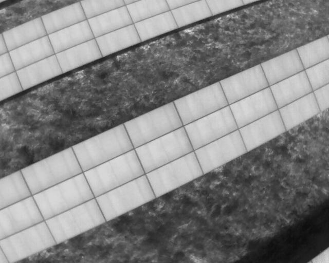

# Engineering results

## Paired field observation

**Figure 3a.** Full thermal view of the field candidate shown in Figure 1. The white ring traces the exact 13-pixel component. The red rectangle is a 6× display locator. The cyan outline indicates the provisional module.

**Figure 3b.** Full RGB view. The operator reported surface debris near the edge. The approximate RGB locator provides context because the held-out local alignment check did not pass.

| Metric | Recorded value |
| --- | ---: |
| Region median temperature | 28.9368 °C |
| Median local temperature residual | +2.95235505 K |
| Exact component size | 13 native pixels |

This observation demonstrates how the software reports a spatially localised candidate and makes the interpretation reviewable. A maintenance finding or repeated inspection would be needed to establish the physical cause. [Figure provenance](assets/IMAGE-CREDITS.md) · [RGB alignment checks](rgb-pair-check.md)

## Native temperature example

**Figure 4.** A real public STR Drones Matrice 4T R-JPEG processed by PV Delta. The map uses a 2nd–98th percentile colour range. The transect uses the underlying native temperature values at row 256. [Dataset, settings and source credit](assets/IMAGE-CREDITS.md)

## PV-array imagery

Show the CERTH reference image

**Figure 5.** CERTH dataset sample depicting repeated PV modules and intervening ground. It gives context for the geometry problem. [Dataset attribution and usage terms](assets/IMAGE-CREDITS.md)

## Processing evidence

The local Matrice 4T acquisition has 1,239 processed thermal frames. This count measures processing volume. The manufacturer comparison reproduced 2,621,440 temperature values over eight M4T/M30T R-JPEGs. [Verification protocol and limits](validation.md)
