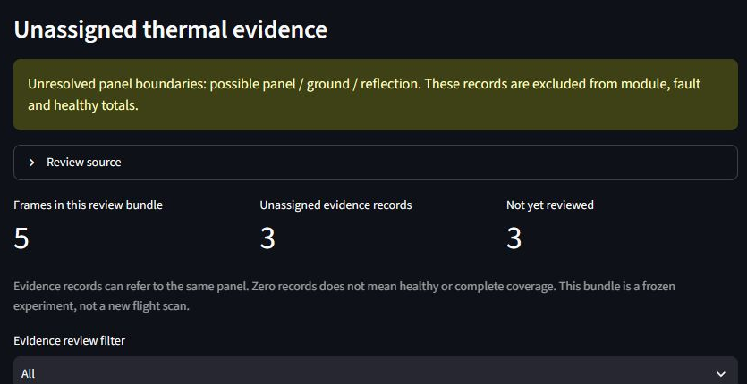

# Dashboard guide

Start the local dashboard with the [Windows launcher](stage1-pilot.md) and choose a mode. **Basic** follows the inspection and review workflow. **Advanced** opens the individual engineering tools. [Dashboard navigation map](diagrams/README.md#dashboard-navigation)

## Basic inspection

1. Open **Start a new inspection** and select a folder with the original R-JPEGs and any paired RGB files. Supply the DJI SDK path when it cannot be resolved automatically.
2. Open the completed inspection overview. Check processing coverage, frame errors and unresolved records before interpreting findings.
3. Review thermal and RGB evidence. The native candidate pixels, display locator and provisional module outline have separate meanings. Check image pairing and registration status before interpreting where a locator falls in RGB. Use **OK**, **Not OK** or **Wait** to record an operator decision. [Figure 1](../README.md#pv-delta) · [Full operator-supplied views in Figure 3](results.md#paired-field-observation)
4. When available, inspect existing surface-assisted runs or launch one using source-bound annotations. Compare revisions and provenance before using those results.

## Advanced workstation

| Application tab | Inputs and method | Output and interpretation |
| --- | --- | --- |
| **Flight plan** | Camera, height, view angle, module dimensions, tilt, overlap and photo interval. Uses a planar footprint approximation. | Thermal sampling, spacing and estimated coverage. Use [capture geometry](methodology.md#capture-geometry) to interpret the estimates. |
| **Field checklist** | Available environmental and operating observations. | Field evidence for review and reporting. Assess gaps against the [field evidence checklist](method.md#6-iec-ts-62446-3-and-field-evidence). |
| **Radiometric scan** | Original R-JPEGs, SDK library and optional RGB. Indexes sources, decodes temperatures and scans usable support. | Run coverage, candidate rows and scan errors. Per-frame observations may repeat physical modules. |
| **Panel boundaries** | Source frames and saved geometry, where available. | Review geometry and save revisions or reference labels. Surface exclusions are source-bound. [Surface constraints](surface-constraints.md) |
| **Unassigned evidence** | Saved thermal evidence with unresolved geometry. | Queue entries for review without assigning them to a confirmed module. Figure 2 shows the separation. |
| **RGB quality** | Available RGB captures and view-comparison inputs. | Relative sharpness and source context for selecting review imagery. [View selection](view-selection.md) |
| **Local data & map** | Inspection store and available capture or projected coordinates. | Coverage, image timeline and geographic context. Camera positions represent the track. [Geolocation](geolocation.md) |
| **User review** | Selected findings and paired evidence. | Review decisions and supporting views. [Review evidence](review-evidence.md) |
| **Orthoview** | Source captures, camera metadata and available projected geometry. | Experimental RGB and thermal overview where sufficient metadata exists. Use native frames for radiometric measurements. [Orthoview scope](orthoview.md) |
| **Export** | Selected local inspection run. | Traceable HTML, JSON and CSV evidence. [Export and verification](inspection-export.md) |
| **Panel review (v2)** | Candidate regions and available same-panel or source-view evidence. | Review multiple regions together with exact thermal support and any qualified RGB transfer. [Review versions](review-versions.md) |

## Unassigned thermal evidence

**Figure 2.** Archived Streamlit view of a five-frame review bundle with three unresolved records. Such a record warrants geometry or surface review. Multiple records may refer to the same panel. [Screenshot provenance](assets/IMAGE-CREDITS.md) · [Queue implementation and meaning](native-gap-review.md)
